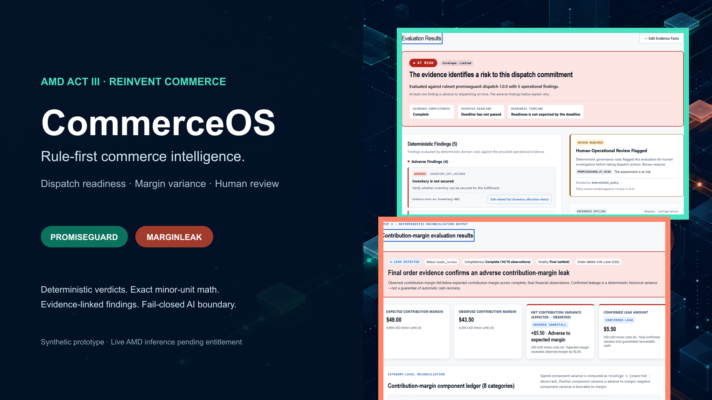

# CommerceOS

CommerceOS is a contract-first commerce operations control room for decisions that should not be delegated to an opaque model. It combines deterministic evaluation, explicit evidence, human-review gates, and an optional server-side inference boundary.

Built for the **AMD Developer Hackathon: ACT III — Reinvent Commerce** track.



## Working prototype

### PromiseGuard

PromiseGuard evaluates whether fulfillment evidence supports an order's dispatch commitment. Its synthetic preview returns `supported`, `at_risk`, or `indeterminate` with evidence-linked findings and explicit human-review policy.

The public application includes the real contract-validated PromiseGuard evaluator and API. The capability remains `stub` because live merchant connectors and production activation are outside this release.

### MarginLeak

MarginLeak evaluates expected-versus-observed contribution-margin variance across eight revenue and cost categories using exact integer minor-unit arithmetic. Missing evidence is never treated as zero, provisional evidence never creates confirmed leakage, and an unprofitable order is not automatically classified as leakage.

MarginLeak remains `planned`. Its interactive page is development/test-only. In production, `/marginleak` returns HTTP `404` and `POST /api/v1/marginleak/analyze` returns HTTP `403` with `MARGINLEAK_PREVIEW_UNAVAILABLE`.

### RescueCart

RescueCart is intentionally disabled.

## Deterministic architecture

```text
Synthetic merchant evidence
  -> strict versioned contracts
  -> deterministic evaluators
  -> evidence-linked findings
  -> human-review policy
  -> versioned API responses
```

- `apps/commerceos` — Next.js application, product routes, APIs, and UI.
- `packages/contracts` — canonical Zod contracts plus generated JSON Schema and OpenAPI.
- `packages/inference` — server-only provider boundary, disabled provider, and deterministic test mock.

Deterministic rules own verdicts, financial calculations, and review decisions. Optional inference can add advisory text only; it cannot overwrite deterministic outputs.

## AMD status

Authenticated AMD Token Factory inference and a controlled local PromiseGuard integration are verified with `DeepSeek-V4-Flash`. The server-only adapter accepts only synthetic evidence, validates structured advisory output, and cannot change the deterministic verdict or human-review policy.

The public deployment still runs with `INFERENCE_PROVIDER=disabled`. Production selection of `amd-token-factory` fails closed until a separately approved access-control and deployment design is in place; this source integration is not authentication for a public model endpoint.

## Local setup

Requirements:

- Node.js `24.16.0`
- pnpm `12.4.2`

```powershell
git clone https://github.com/Rizvee355/CommerceOS-ACTIII.git
Set-Location CommerceOS-ACTIII
pnpm install --frozen-lockfile
$env:INFERENCE_PROVIDER = "disabled"
pnpm check
pnpm dev
```

Open:

- Overview: `http://localhost:3000/`
- PromiseGuard: `http://localhost:3000/promiseguard`
- Health: `http://localhost:3000/api/v1/health`
- Capabilities: `http://localhost:3000/api/v1/capabilities`

For the development-only MarginLeak demonstration, bind explicitly to loopback:

```powershell
$env:INFERENCE_PROVIDER = "disabled"
pnpm --filter @commerceos/app dev --hostname 127.0.0.1 --port 3000
```

Never expose the development server to an untrusted network.

## Verification

```powershell
pnpm check
pnpm security:deps
pnpm test:e2e
pnpm exec playwright test --config=playwright.dev.config.ts
```

The production browser suite verifies that PromiseGuard remains usable while MarginLeak fails closed. The development suite verifies MarginLeak's synthetic workflows.

## Submission assets

- [Pitch presentation](submission-assets/CommerceOS-ACT-III-Pitch.pptx)
- [Pitch PDF](submission-assets/CommerceOS-ACT-III-Pitch.pdf)
- [Authentic application demo](submission-assets/CommerceOS-demo-silent.webm)
- [Asset checksums and provenance](submission-assets/ASSET_MANIFEST.md)

## Security boundaries

- Never commit credentials, cookies, authorization headers, or raw provider responses.
- AMD credentials remain server-only; production inference is disabled and mock inference is not a production fallback.
- CI performs no live provider calls.
- Monetary values use integer minor units.
- Missing financial evidence is never coerced to zero.
- The production MarginLeak guard must not be weakened for a demo.

See [SECURITY.md](SECURITY.md) and [docs/security/FOUNDATION-BASELINE.md](docs/security/FOUNDATION-BASELINE.md).

## License

Operator-owned CommerceOS source code is released under the [MIT License](LICENSE). Third-party dependencies and tooling remain under their respective licenses; see [THIRD_PARTY_NOTICES.md](THIRD_PARTY_NOTICES.md).
